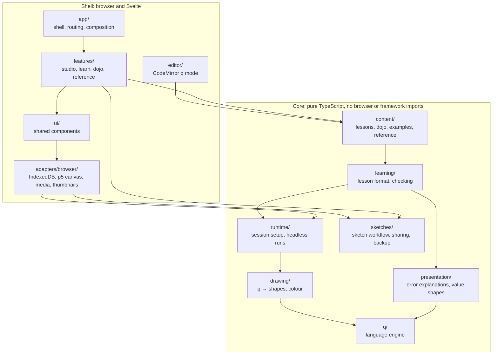
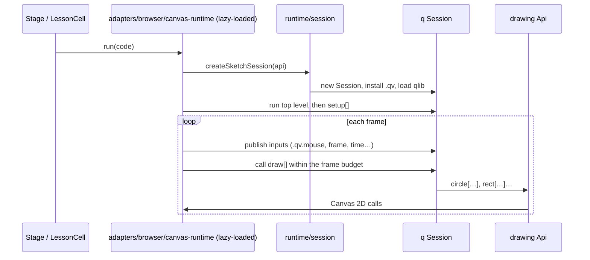

# Qanvas architecture

Qanvas is a static single-page app. Everything happens on the device: a q interpreter written in
TypeScript evaluates code, a drawing layer turns q values into Canvas 2D calls, and sketches and
progress are saved in IndexedDB. Cloudflare only serves files.

The code is organised so that **one kind of change lives in one place**, and so that the parts most
people touch (lessons, drawing functions, UI) can't accidentally reach into the parts that need
care (the interpreter, saved-data formats).

## Module map



Arrows mean "may import". The rules are enforced by `tools/check-architecture.mjs`, which runs as
part of `npm run check` (and therefore in CI). If you need something across a boundary the rules
forbid, pass it in through a port (an interface the caller implements), as `SketchController` does.

| Folder | Owns | Change it when you want to… |
|---|---|---|
| `q/` | Lexer, parser, evaluator, values, primitives, qSQL, formatting | change what q code means or prints |
| `drawing/` | The `.qv` drawing API, colour parsing, value conversion, the `Surface` port | add or change a drawing function |
| `runtime/` | Creating a sketch session; running code headless (thumbnails, checks) | change how a program is started, budgeted or recorded |
| `presentation/` | Plain-English error help, value shape descriptions | change how errors or values are explained |
| `learning/` | Lesson Markdown format, challenge checking, progress types | change the lesson format or how answers are checked |
| `sketches/` | `SketchController` (edit → save → autorun), share links, backups, copies, recovery | change saving, autosave timing, share or backup formats |
| `content/` | Lessons, dojo problems, examples, reference entries | write or edit learning material |
| `adapters/browser/` | IndexedDB, localStorage recovery, p5 live canvas, camera/mic/audio | change a browser integration |
| `editor/` | Syntax highlighting, completion, editor extensions | change the code editor |
| `ui/` | Components shared by several features (`Stage`, `Console`, `CodeEditor`…) | change a shared component |
| `features/` | One folder per tab | change a screen |
| `app/` | `App.svelte` shell, hash routing, global state, layout helpers, wiring (`bootstrap.ts`) | change navigation or how modules are connected |

## Running a program



The p5-based canvas runtime is the largest dependency, so it is code-split. `Stage` imports it on
first use, so the Learn, Dojo and Reference tabs start without it.

## Rules that keep it fast and safe to change

**Each q `Session` owns its runtime context.** Primitives reach session services (random numbers,
output, function application, budgets) through `RT` in `q/rt.ts`. A session builds its context
once, and `withRuntime` makes it current for the duration of a call. If a host callback re-enters
another session, the caller's context is restored afterwards. Numeric kernels are plain functions
with no extra indirection.

**Execution is always budgeted.** `Session.withBudget(ms, fn)` sets a cooperative deadline. Nested
budgets can only shorten the outer one. Top-level code, each frame, thumbnails and each challenge
check all run under one.

**Fast paths must agree with the general evaluator.** `new Session({ fastPaths: false })` disables
the specialised reductions in `q/fastpaths.ts`, so you can compare both paths on the same input.

**Content has permanent IDs.** Every lesson declares `id:` in its front matter, and every q fence
declares `id=…`. Progress is stored against those IDs, so you can rename files, reorder lessons or
insert cells without losing anyone's progress. The build fails if an ID is missing or duplicated,
or if a challenge has no checks or solution. Lessons are compiled from Markdown at build time by
`tools/content-plugin.ts`, so no Markdown parser ships to the browser.

````markdown
```q sketch id=hello:3
circle[center;150]
```
````

**Decisions live in plain classes and functions; effects stay at the edges.** `SketchController`
decides what to save and when to auto-run. It talks to storage, timers and the view only through
`SketchPorts`, which `app/bootstrap.ts` wires to the browser. Saves are serialised, and a save that
finishes late can't mark newer edits as saved.

**Saved formats are compatibility promises.** Share links (`sketches/share.ts`), backups
(`sketches/backup.ts`) and the pending-edit recovery stash
(`adapters/browser/persistence.ts`) must keep reading data written by older versions.

## Common changes

- **Add a drawing function:** implement it in `drawing/api.ts`, then document it in
  `content/reference.ts`. The editor picks the name up for highlighting and completion.
- **Add a lesson:** add `content/lessons/NN-name.md` with a new `id:`. Give each q fence a new
  `id=`. Files are ordered by name.
- **Add a dojo problem:** add a `q challenge id=dojo:…` fence to a file in `content/dojo/`.
- **Change autosave timing:** `sketches/controller.ts`.
- **Swap the storage backend:** implement the `SketchStore` shape from `sketches/model.ts` in a
  new adapter, then wire it in `app/bootstrap.ts`.
- **Change a q primitive:** `q/verbs.ts`, `q/atomic.ts` or `q/tables.ts`. Check the change against
  real q with `tools/oracle.mjs` and `tools/diff.ts`, then add the expression to a `test/corpus/*.q`
  file.

## Checks

```bash
npm run check   # architecture boundaries + TypeScript/Svelte types
npm test        # q parity against real-q output, every lesson/dojo solution, formats
npm run build   # also validates all lesson content
```
